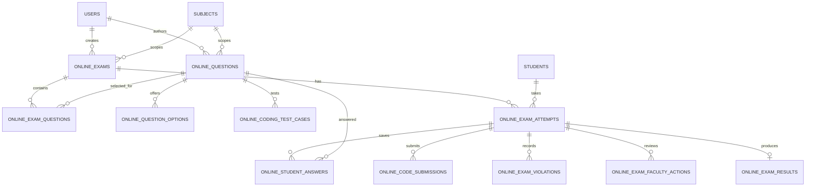

# Online examination module

## Architecture

EduPilot remains the desktop client for the single-machine phase. The exam domain is being separated into services so the same workflows can later be called by a FastAPI service for multi-device use. PostgreSQL will hold shared exams and attempts; SQLite remains for device-local preferences. A separate restricted Docker runner will compile and execute student programs. It must never execute submitted code in the desktop process or API process.

Browser/full-screen events are deterrence signals. The system records them, warns students, and can pause an attempt for faculty review; it cannot guarantee prevention of screenshots, second devices, or operating-system switching.

## Data relationships

Correct answers and hidden test cases remain in faculty-only service queries. Student-facing queries return question prompts and public options only.

## Implementation stages

1. **Evaluation and schema:** added portable tables for exams, reusable questions/options, coding cases, attempts, answers, violations, faculty decisions, code submissions, and results. Added deterministic grading for MCQ, multiple-select, true/false, and fill-in questions. Descriptive answers remain pending faculty review; programming scoring accepts outcomes from a trusted sandbox only.
2. **Faculty authoring:** draft-exam/question-bank service operations now create exams and supported question types, validate options and hidden test cases, attach owned questions, preview the answer key, and publish a validated total. Faculty authoring UI, edit/delete/import controls, and schedule dashboards remain pending.
3. **Student attempts:** the desktop student page now lists published exams, starts or resumes an attempt in fullscreen, uses the database service's authoritative deadline, saves structured answers, and submits objective scores. It persists each student's question/option order. Faculty intervention, violation logging, remote API timing, and structured programming execution remain pending.
4. **Evaluation and faculty review:** hidden-case code execution, review overrides, results, violation intervention, and dashboard.
5. **Online deployment:** authenticated API, authorization, PostgreSQL migrations, WebSocket notifications, rate limits, deployment settings, and cross-device file service.

The existing `lab_exams` practical-paper page is retained during migration. The new online-exam tables and evaluator are not presented as a finished online exam workflow until the authoring, attempt, API, and result screens are connected.
